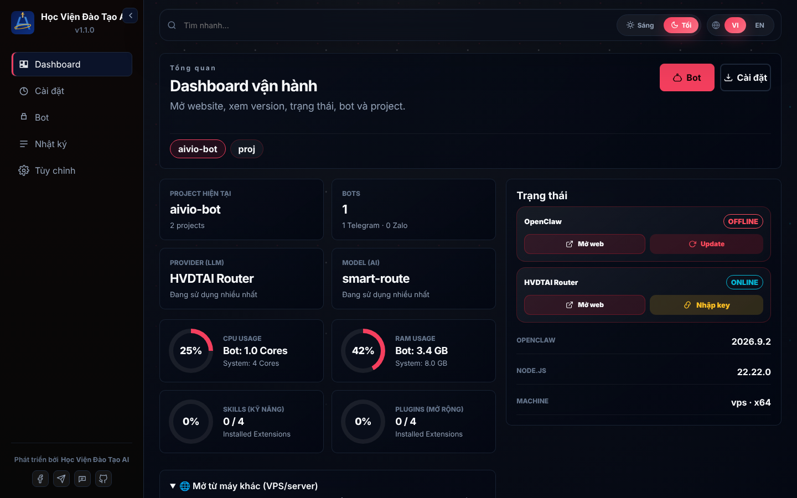
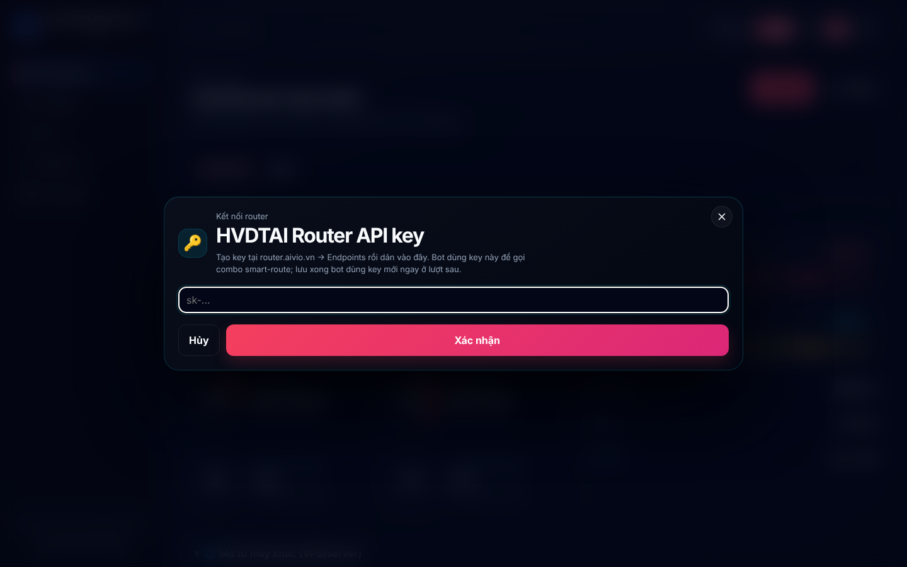

<div align="center">

# 🎓 Học Viện Đào Tạo AI — Bot Setup

### Tạo chatbot AI cho Telegram, Zalo và Facebook Messenger, chạy trên OpenClaw, gọi AI qua HVDTAI Router

*Chạy một lệnh → mở giao diện web → tạo bot. Windows, macOS, Linux, VPS.*

<p align="center">
  
  <a href="https://router.aivio.vn"></a>
  
</p>

**Tiếng Việt** · [English](README.md)



</div>

---

## Cách hệ thống hoạt động

Aivio Bot Setup là giao diện web chạy trên máy anh/chị, dùng để cài và cấu hình [OpenClaw](https://openclaw.ai). Bot chạy trong OpenClaw Gateway như một service của hệ điều hành, nhận tin từ các kênh chat và gọi AI qua **HVDTAI Router** tại `https://router.aivio.vn/v1`.

```text
Telegram      ─┐
Zalo Bot API  ─┤
Zalo cá nhân  ─┼─► OpenClaw Gateway ──HTTPS──► router.aivio.vn ──► Gemini · Claude · OpenAI
Messenger     ─┘   (127.0.0.1:18789)           (combo smart-route)
                          ▲
                          │ cài và cấu hình
                   Aivio Bot Setup (127.0.0.1:51789)
```

| Thành phần | Phiên bản / vị trí |
|---|---|
| Aivio Bot Setup | v1.1.0 |
| OpenClaw | `openclaw@2026.9.2` (cài global qua npm) |
| Router AI | `https://router.aivio.vn/v1`, model `9router/smart-route` |
| Cấu hình bot | `<project>/.openclaw/openclaw.json` và `<project>/.env` |

---

## 1. Chuẩn bị

| Phần mềm | Yêu cầu | Kiểm tra |
|---|---|---|
| Node.js | 24 LTS trở lên | `node -v` |
| Git | Bản mới, có trong PATH | `git --version` |

```bash
# Windows (PowerShell)
winget install OpenJS.NodeJS.LTS
winget install Git.Git

# macOS
brew install node@24 git

# Ubuntu / Debian / VPS
curl -fsSL https://deb.nodesource.com/setup_24.x | sudo -E bash -
sudo apt-get install -y nodejs git
```

Trên VPS, bật linger để bot không tắt khi đóng SSH: `sudo loginctl enable-linger $USER`.

---

## 2. Chạy giao diện Setup

**Cách 1 — chạy thẳng từ GitHub (khuyên dùng):**

```bash
npx --yes github:theanh828726/aivio-setup
```

**Cách 2 — clone repo:**

```bash
git clone https://github.com/theanh828726/aivio-setup.git
cd aivio-setup
npm start
```

Giao diện mở tại `http://127.0.0.1:51789`. Chạy lại đúng lệnh trên để mở lại sau này. Nếu Setup đang chạy sẵn, lệnh mới sẽ dùng lại instance đó.

| Tuỳ chọn | Tác dụng |
|---|---|
| `--port=<cổng>` | Đổi cổng giao diện (mặc định 51789) |
| `--host=<địa chỉ>` | Địa chỉ lắng nghe (mặc định 127.0.0.1) |
| `--project-dir=<đường dẫn>` | Mở thẳng một project |
| `--no-open` | Không tự mở trình duyệt (dùng trên VPS) |
| `-v`, `-h` | In phiên bản / trợ giúp |

Khi chạy bằng `npm start`, truyền tuỳ chọn sau `--`, ví dụ `npm start -- --no-open`.

Trên VPS không có trình duyệt, mở SSH tunnel từ máy của anh/chị rồi vào `http://localhost:51789`:

```bash
ssh -L 51789:127.0.0.1:51789 -L 18789:127.0.0.1:18789 -L 18790:127.0.0.1:18790 <user>@<server>
```

---

## 3. Chuẩn bị HVDTAI Router

Bot gọi model `smart-route`, nên router phải có một combo tên đúng `smart-route`.

1. Đăng nhập `https://router.aivio.vn`.
2. **Providers** → kết nối Gemini, Claude, OpenAI… (OAuth hoặc API key).
3. **Combos** → tạo combo tên `smart-route` → thêm model theo thứ tự ưu tiên.
4. **Endpoints** → tạo API key cho bot → copy.

Kiểm tra key trước khi gắn vào bot:

```bash
curl -s https://router.aivio.vn/v1/chat/completions \
  -H "Authorization: Bearer <API_KEY>" \
  -H "Content-Type: application/json" \
  -d '{"model":"smart-route","messages":[{"role":"user","content":"Xin chào"}]}'
```

Kết quả đúng là JSON có `choices[0].message.content`. Lỗi 401 nghĩa là key sai. Lỗi model not found nghĩa là chưa có combo `smart-route`.

---

## 4. Cài OpenClaw và gắn API key

1. Tab **Cài đặt** → chọn hệ điều hành → chế độ **Native** (Docker đã ngừng cho project mới).
2. **Tạo Bot** → nhập đường dẫn project, ví dụ `D:\aivio-bot`, `/Users/<tên>/aivio-bot`, `/home/<tên>/aivio-bot` → theo dõi Nhật ký đến khi xong.
3. Tab **Dashboard** → thẻ **HVDTAI Router** → bấm **Nhập key** → dán API key ở bước 3 → **Xác nhận**.



Lưu key ở đây sẽ ghi vào `openclaw.json` và `.env` (`NINE_ROUTER_API_KEY`). Đồng thời, Setup xoá auth profile cũ mà OpenClaw còn giữ key giả `sk-no-key`, nên bot dùng key mới ngay từ lượt sau.

---

## 5. Tạo bot và kết nối kênh

Tab **Bot** → **Tạo bot** → chọn kênh → điền tên, mô tả, thông tin chủ nhân (Owner) → **Tạo bot**. Tính cách bot sửa trong `SOUL.md`, `AGENTS.md` ở mục file của bot.

| Kênh | Cần chuẩn bị | Cách nhận tin |
|---|---|---|
| Telegram | Bot token từ [@BotFather](https://t.me/BotFather) | Long-polling, không cần webhook |
| Zalo Bot API | Bot token từ [bot.zaloplatforms.com](https://bot.zaloplatforms.com) | Long-polling, không cần webhook |
| Zalo cá nhân | Một tài khoản Zalo **phụ**, quét QR | Plugin OpenClaw Zalo Connect (không chính thức) |
| Facebook Messenger | Meta App, Page token, App Secret, Verify Token | Webhook HTTPS public |

**Zalo Bot API:** kiểm tra token bằng `curl https://bot-api.zaloplatforms.com/bot<token>/getMe`. Muốn đưa bot vào nhóm, mở mini app **Zalo Bot Creator** → **Mời Bot vào nhóm** → trưởng nhóm bấm link xác nhận. Trong nhóm, bot chỉ phản hồi khi được @mention hoặc khi có người reply tin của bot.

**Zalo cá nhân:** tạo bot xong bấm **Đăng nhập Zalo** và quét QR. Tự động hoá tài khoản cá nhân có thể vi phạm điều khoản Zalo, nên chỉ dùng tài khoản phụ.

**Facebook Messenger:** sau khi tạo bot, mở **Bot → Plugins** → **Cài** thẻ `openclaw-fb-messenger`. Sau đó mở gateway ra HTTPS public (ngrok, Cloudflare Tunnel hoặc nginx/Caddy). Khai báo Callback URL `https://<domain>/webhooks/messenger` trong Meta → Messenger → Webhooks, subscribe `messages`.

```bash
ngrok http --url=<ten>.ngrok-free.app 18789
curl "https://<domain>/webhooks/messenger?hub.mode=subscribe&hub.verify_token=<VERIFY_TOKEN>&hub.challenge=ping"   # phải trả về: ping
```

---

## 6. Vận hành bằng OpenClaw CLI

Hằng ngày dùng các nút trên giao diện là đủ. Khi cần gõ lệnh, đứng trong thư mục project và đặt biến môi trường trước:

```bash
cd <project>
export OPENCLAW_HOME="$PWD/.openclaw" OPENCLAW_STATE_DIR="$PWD/.openclaw"
# PowerShell: $env:OPENCLAW_HOME="$PWD\.openclaw"; $env:OPENCLAW_STATE_DIR="$PWD\.openclaw"
```

| Việc cần làm | Lệnh |
|---|---|
| Bật / tắt / khởi động lại bot | `openclaw daemon start` · `stop` · `restart` |
| Trạng thái gateway | `openclaw gateway status --json --no-probe` |
| Trạng thái kênh | `openclaw channels status` |
| Đăng nhập lại Zalo cá nhân | `openclaw channels login --channel zalo-connect --account default` |
| Kiểm tra cấu hình | `openclaw config validate` |
| Xem router đang dùng | `openclaw config get "models.providers['9router'].baseUrl" --json` |
| Tự sửa cấu hình lỗi thời | `openclaw doctor --fix` |
| Xem / xoá auth profile của model | `openclaw models auth list` · `openclaw models auth logout <profileId> --yes` |

| Cổng | Dịch vụ |
|---|---|
| 51789 | Giao diện Setup |
| 18789 | OpenClaw Gateway (Control UI, webhook Messenger) |
| 18790 | Zalo Mod dashboard (luôn bằng gateway + 1) |

Hướng dẫn chi tiết hơn và bảng xử lý sự cố: [docs/SETUP.vi.md](docs/SETUP.vi.md).

---

## 7. Biến môi trường của Setup

| Biến | Mặc định | Tác dụng |
|---|---|---|
| `AIVIO_ROUTER_MODE` | `remote` | Đặt `local` để bot mới dùng 9Router cục bộ (`127.0.0.1:20128`) thay cho router.aivio.vn |
| `AIVIO_SETUP_SPEC` | `github:theanh828726/aivio-setup` | Nguồn tải khi bấm **Cập nhật**, ví dụ `create-aivio-bot@latest` sau khi publish npm |

---

## 8. Phát triển

```text
aivio-setup/
|-- src/            ← mã nguồn: cli/, server/, setup/data/, setup/shared/, web/
|-- dist/           ← bản build được commit (npx và clone chạy thẳng từ đây)
|-- scripts/build.mjs
`-- docs/
```

- Chỉ sửa trong `src/`, rồi chạy `npm run build` để sinh lại `dist/`.
- `npm run check:dist` báo lỗi nếu `dist/` lệch với `src/`. Nên chạy trước mỗi commit.
- Phát hành: tăng `version` trong `package.json` → `npm run build` → commit → push `master`. Người dùng bấm **Cập nhật** sẽ nhận bản mới.
- Publish npm (tuỳ chọn): `npm login` rồi `npm publish`. Sau đó `npx create-aivio-bot` dùng được, và có thể đặt `AIVIO_SETUP_SPEC=create-aivio-bot@latest`.

---

## Ghi công

Phát triển bởi **[Học Viện Đào Tạo AI](https://hocvienai.com)**.

Dựa trên [OpenClaw Setup](https://github.com/tuanminhhole/openclaw-setup) của tuanminhhole (MIT). Lịch sử thay đổi của bản gốc nằm ở [docs/upstream](docs/upstream). Bot chạy trên [OpenClaw](https://openclaw.ai); các plugin Zalo Connect, Zalo Mod, fb-messenger được cài từ [ClawHub](https://clawhub.com).

MIT License — xem [LICENSE](LICENSE).
